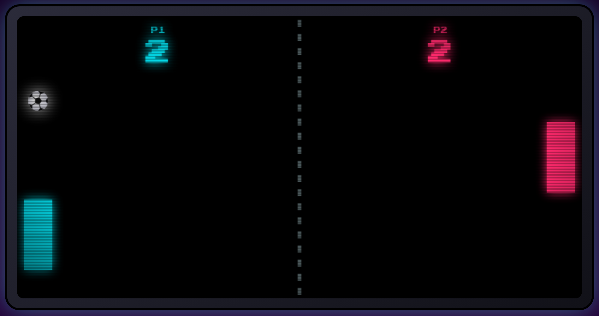
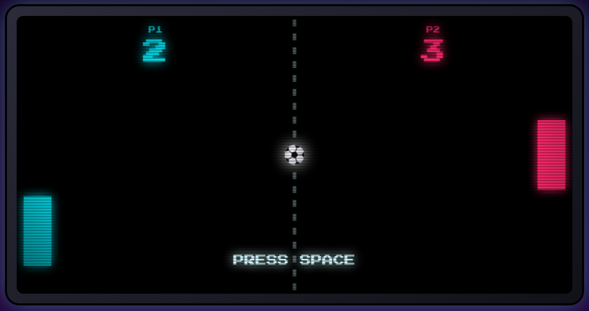
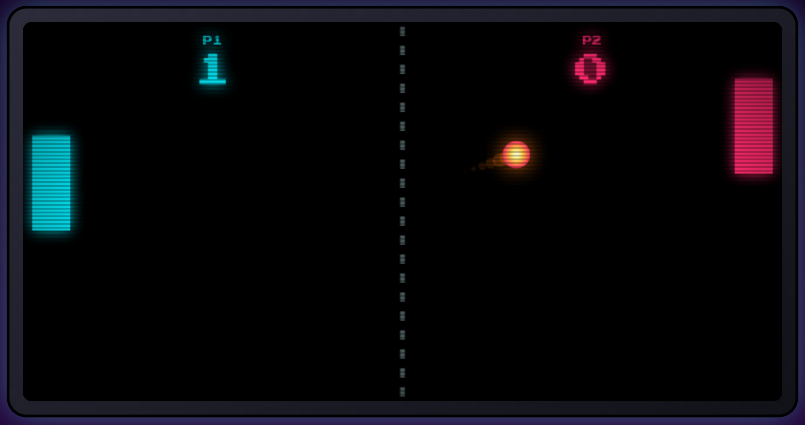
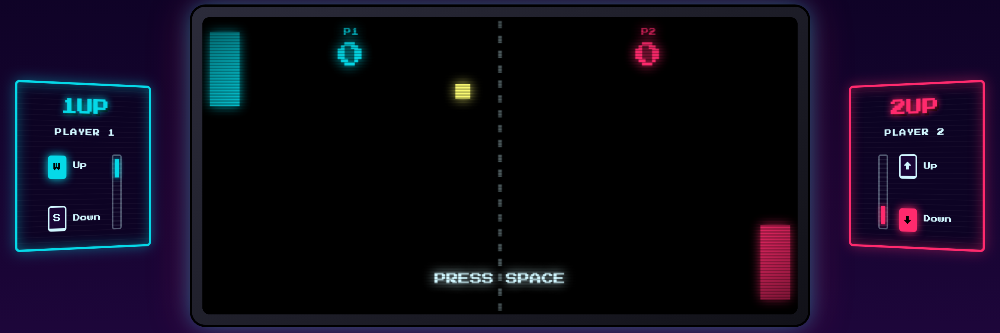
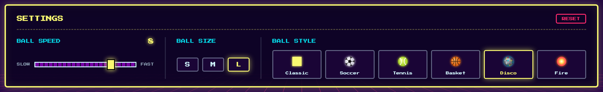
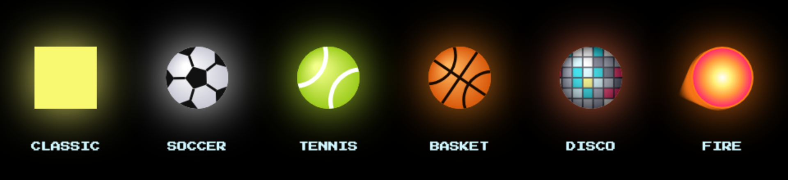
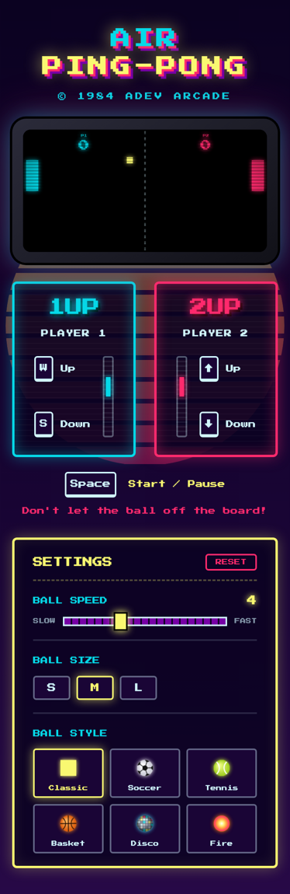

<a id="top"></a>

<h1 align="center">🕹️ Air Ping-Pong</h1>

<p align="center">
  A two-player, 80s arcade-style ping-pong game built with vanilla JavaScript, OOP and the MVC pattern.
</p>

<p align="center">
  <a href="https://ping.nesst-tech.online/">
    
  </a>
</p>

<p align="center">
  
  
  
</p>

<p align="center">
  <a href="https://ping.nesst-tech.online/">
    
  </a>
</p>

## Contents

- [Features](#features)
  - [Arcade look and feel](#arcade-look-and-feel)
  - [Scoreboard](#scoreboard)
  - [Collisions and ball physics](#collisions-and-ball-physics)
  - [Player control decks](#player-control-decks)
  - [Settings panel](#settings-panel)
  - [Ball styles](#ball-styles)
  - [Responsive layout](#responsive-layout)
- [How to play](#how-to-play)
- [Project structure](#project-structure)
- [Getting started](#getting-started)
- [Branching model](#branching-model)
- [Background](#background)

---

## Features

### Arcade look and feel

- Synthwave palette (cyan for Player 1, pink for Player 2, yellow for the UI) with neon glow on the paddles, the ball and the score.
- *Press Start 2P* pixel font, a CRT screen frame with scanlines and vignette, a dashed center net, and a retro sun and moving grid in the background.
- The title flickers and the hints blink like an old arcade cabinet. All animations turn off when the system's *reduce motion* setting is on.

### Scoreboard

Each player's score is drawn at the top of their half of the table. When the ball leaves the board, the **opponent** scores:

<table>
  <tr>
    <td align="center" width="50%">
      <br>
      <sub><b>1.</b> The ball gets past Player 1 and leaves on the left side. Score: <b>2 – 2</b>.</sub>
    </td>
    <td align="center" width="50%">
      <br>
      <sub><b>2.</b> Player 2 scores (<b>2 – 3</b>). The ball returns to the center and the game waits for the next serve.</sub>
    </td>
  </tr>
</table>

How a point works:

| Step | What happens |
|---|---|
| Ball leaves on the **left** | **P2** gets a point |
| Ball leaves on the **right** | **P1** gets a point |
| After the point | The ball goes back to the center, its vertical speed resets, and its trail is cleared |
| Next serve | The ball heads toward the player who **lost** the point |
| Pause | The game pauses and shows a blinking **PRESS SPACE** until <kbd>Space</kbd> is pressed |

### Collisions and ball physics

<p align="center">
  
</p>

- **Top and bottom walls:** the ball bounces off both edges and is pushed back inside the board, so it never gets stuck in a wall.
- **Paddle limits:** paddles stop at the top and bottom edges of the table.
- **Paddle bounce:** the bounce angle depends on where the ball hits the paddle. Hits closer to the edges send it off at a sharper angle.
- **Motion effects:** the ball spins as it rolls, and the *Fire* style leaves a flame trail.

### Player control decks

<p align="center">
  
</p>

Each player has a control deck on their side of the screen, tilted toward it like the side panels of an arcade cabinet:

- **1UP / 2UP** tag blinking in the player's color.
- **Live keys:** each key lights up and "sinks" while it's held down. In the image, Player 1 is holding <kbd>W</kbd> and Player 2 is holding <kbd>↓</kbd>. The <kbd>Space</kbd> hint lights up too.
- **Paddle radar:** a vertical rail with a mini paddle that mirrors the real paddle's position in real time. The rail sits on the side facing the screen.

### Settings panel

<p align="center">
  
</p>

| Setting | Options | Default | Details |
|---|---|---|---|
| **Ball speed** | 1 to 10 | 4 | Pixels per frame (1 is the original speed). Changing it mid-rally keeps the ball's direction and angle. |
| **Ball size** | S · M · L | M | Radius of 6, 10 or 14 px. Collisions use the new size right away. |
| **Ball style** | 6 styles | Classic | See [Ball styles](#ball-styles). Each option shows an animated preview. |
| **Reset** | — | — | Restores the default values. |

- Every change applies immediately, even while playing.
- Settings are saved in the browser (`localStorage`), so they're still there after a reload. In private mode they just don't persist.
- After clicking an option, the keyboard focus goes back to the game, so <kbd>W</kbd> / <kbd>S</kbd> / arrows / <kbd>Space</kbd> keep controlling the match.

### Ball styles

<p align="center">
  
</p>

| Style | Look |
|---|---|
| **Classic** | Yellow square, like the original arcade Pong |
| **Soccer** | White ball with black pentagons that rotate as it rolls |
| **Tennis** | Yellow-green ball with white seams |
| **Basket** | Orange ball with black lines |
| **Disco** | Mirror tiles that sparkle in neon colors, with a color-cycling halo |
| **Fire** | Flickering fireball that leaves a flame trail |

All styles are drawn on the canvas (no image files), so they stay sharp at any size.

### Responsive layout

<table>
  <tr>
    <td width="300"></td>
    <td>
      <ul>
        <li><b>Desktop:</b> player decks on each side of the screen and the settings panel in a single row.</li>
        <li><b>Below 1100px:</b> the decks move under the screen, side by side, without the tilt.</li>
        <li><b>Below 760px:</b> the settings stack vertically and the ball styles show in two rows of three.</li>
        <li>The title breaks into <i>AIR</i> / <i>PING-PONG</i> without splitting the word.</li>
      </ul>
    </td>
  </tr>
</table>

---

## How to play

| Action | Player 1 | Player 2 |
|---|---|---|
| Move up | <kbd>W</kbd> | <kbd>↑</kbd> |
| Move down | <kbd>S</kbd> | <kbd>↓</kbd> |
| Start / pause | <kbd>Space</kbd> | <kbd>Space</kbd> |

Don't let the ball off the board!

## Project structure

```
├── index.html
├── styles/
│   └── styles.css
├── docs/images/            # README screenshots
└── javascript/
    ├── Model/
    │   ├── board.model.js      # Board size, game state and score
    │   ├── ball.model.js       # Movement, wall/paddle collisions, reset and speed
    │   ├── bar.model.js        # Paddles limited to the table
    │   └── settings.model.js   # Speed, size and style saved in localStorage
    ├── View/
    │   ├── board.view.js       # Canvas rendering, net, score and goal detection
    │   ├── ball.skins.js       # Procedural drawing of the 6 ball styles
    │   └── settings.view.js    # Settings panel and animated previews
    └── Controller/
        └── view.controller.js  # Keyboard input, game loop, key hints and paddle radar
```

## Getting started

The game uses native ES modules, so it must be served over HTTP (opening `index.html` directly from the file system won't work).

1. Clone the repo

   ```bash
   # HTTPS
   git clone https://github.com/nqs48/Ping-Pong_JS-SofkaTrainning-Campus.git

   # SSH
   git clone git@github.com:nqs48/Ping-Pong_JS-SofkaTrainning-Campus.git
   ```

2. Serve the project root with any static server, for example:

   - **VS Code:** the *Live Server* extension.
   - **Python:**

     ```bash
     python3 -m http.server 8080
     ```

     Then open [http://localhost:8080](http://localhost:8080).

## Branching model

This repository follows **Git Flow**:

| Branch | Created from | Merged into | Purpose |
|---|---|---|---|
| `main` | — | — | Production (deployed site) |
| `develop` | `main` | `main` | Integration of finished work |
| `feature/*`, `docs/*` | `develop` | `develop` | New features and documentation |
| `release/x.y.z` | `develop` | `main` and `develop` | Release preparation, tagged `vX.Y.Z` |
| `hotfix/*` | `main` | `main` and `develop` | Urgent production fixes |

Commits follow [Conventional Commits](https://www.conventionalcommits.org/).

---

## Background

This project started as the 6-part MVC practice of the Sofka Training Campus: a ping-pong game in JavaScript using OOP and the MVC pattern, versioned with Git and deployed online.

## Built with

- [JavaScript](https://developer.mozilla.org/en-US/docs/Web/JavaScript) (ES modules, Canvas API)
- [HTML5](https://developer.mozilla.org/en-US/docs/Web/HTML) & [CSS3](https://developer.mozilla.org/en-US/docs/Web/CSS)
- [Press Start 2P](https://fonts.google.com/specimen/Press+Start+2P) font
- [Git](https://git-scm.com/)

## License

Distributed under the ISC License, as declared in `package.json`.

## Author

**Nestor Quiroga Suárez**: [LinkedIn](https://www.linkedin.com/in/nqs48/)

<p align="center">
  <a href="https://ping.nesst-tech.online/"><strong>▶ Play Air Ping-Pong</strong></a>
  ·
  <a href="#top">Back to top ↑</a>
</p>
