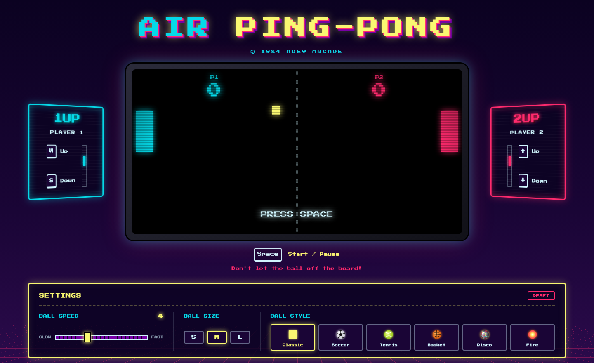

<a id="top"></a>

<h1 align="center">🕹️ Air Ping-Pong</h1>

<p align="center">
  A two-player, 80s arcade-style ping-pong game built with vanilla JavaScript, OOP and the MVC pattern.
</p>

<p align="center">
  <a href="https://ping.nesst-tech.online/">
    
  </a>
</p>

<p align="center">
  
  
  
</p>

<p align="center">
  <a href="https://ping.nesst-tech.online/">
    
  </a>
</p>

---

## Features

- **Arcade look & feel:** synthwave palette, *Press Start 2P* pixel font, CRT screen with scanlines and neon glow.
- **Two local players:** each player has a side deck (1UP / 2UP) whose keys light up while pressed and a mini radar that mirrors the paddle position.
- **Scoreboard:** a point is scored when the ball leaves the board on the opponent's side; the ball returns to the center and waits for the next serve.
- **Collision limits:** the ball bounces off the top and bottom edges and paddles can't leave the table.
- **Settings panel** (saved in the browser):
  - Ball speed from 1 to 10.
  - Ball size S / M / L.
  - Ball style: Classic, Soccer, Tennis, Basket, Disco and Fire.

## How to play

| Action | Player 1 | Player 2 |
|---|---|---|
| Move up | <kbd>W</kbd> | <kbd>↑</kbd> |
| Move down | <kbd>S</kbd> | <kbd>↓</kbd> |
| Start / pause | <kbd>Space</kbd> | <kbd>Space</kbd> |

Don't let the ball off the board!

---

## Project structure

```
├── index.html
├── styles/
│   └── styles.css
└── javascript/
    ├── Model/          # Game state: board, ball, bars and settings
    ├── View/           # Canvas rendering, ball skins and settings panel
    └── Controller/     # Keyboard input, game loop and wiring
```

## Getting started

The game uses native ES modules, so it must be served over HTTP (opening `index.html` directly from the file system won't work).

1. Clone the repo

   ```bash
   # HTTPS
   git clone https://github.com/nqs48/Ping-Pong_JS-SofkaTrainning-Campus.git

   # SSH
   git clone git@github.com:nqs48/Ping-Pong_JS-SofkaTrainning-Campus.git
   ```

2. Serve the project root with any static server, for example:

   - **VS Code:** the *Live Server* extension.
   - **Python:**

     ```bash
     python3 -m http.server 8080
     ```

     Then open [http://localhost:8080](http://localhost:8080).

## Branching model

This repository follows **Git Flow**:

| Branch | Created from | Merged into | Purpose |
|---|---|---|---|
| `main` | — | — | Production (deployed site) |
| `develop` | `main` | `main` via `release/*` | Integration of finished work |
| `feature/*` | `develop` | `develop` | New features |
| `release/x.y.z` | `develop` | `main` and `develop` | Release preparation, tagged `vX.Y.Z` |
| `hotfix/*` | `main` | `main` and `develop` | Urgent production fixes |

Commits follow [Conventional Commits](https://www.conventionalcommits.org/).

---

## Background

This project started as the 6-part MVC practice of the Sofka Training Campus: a ping-pong game in JavaScript using OOP and the MVC pattern, versioned with Git and deployed online.

## Built with

- [JavaScript](https://developer.mozilla.org/en-US/docs/Web/JavaScript) (ES modules, Canvas API)
- [HTML5](https://developer.mozilla.org/en-US/docs/Web/HTML) & [CSS3](https://developer.mozilla.org/en-US/docs/Web/CSS)
- [Press Start 2P](https://fonts.google.com/specimen/Press+Start+2P) font
- [Git](https://git-scm.com/)

## License

Distributed under the ISC License, as declared in `package.json`.

## Author

**Nestor Quiroga Suárez**: [LinkedIn](https://www.linkedin.com/in/nqs48/)

<p align="center">
  <a href="https://ping.nesst-tech.online/"><strong>▶ Play Air Ping-Pong</strong></a>
  ·
  <a href="#top">Back to top ↑</a>
</p>
